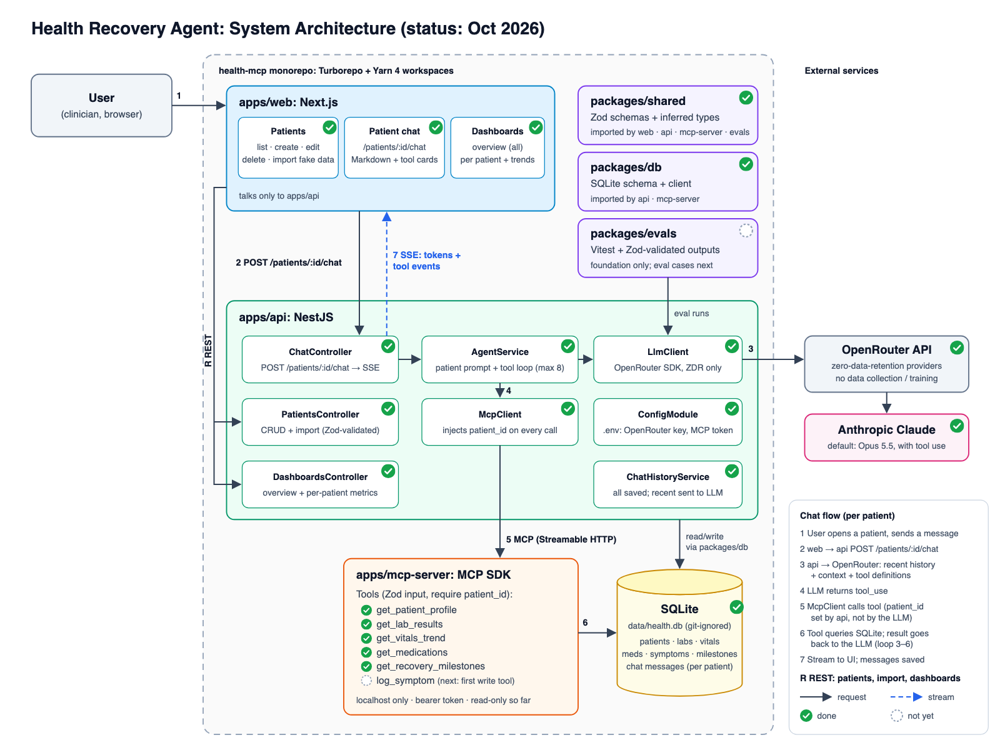

# health-mcp

An AI health-recovery assistant. Clinicians manage patients, review dashboards, and chat with an agent about one patient at a time. The agent answers by calling MCP tools that read that patient's health records.

> **Data policy:** this project is shared for learning purposes. Only synthetic or redacted data may be used. Real health data and API keys must never be committed. `data/`, `*.db` and `.env*` are git-ignored.

## Architecture



The editable source is [`docs/architecture.svg`](docs/architecture.svg).

### Components

| Workspace | Tech | Responsibility |
|---|---|---|
| `apps/web` | Next.js | **Patients**: list, create, import fake data. **Patient chat** (`/patients/:id/chat`): streams tokens and tool-call cards. **Dashboards**: an overview of all patients and a per-patient view. Talks only to `apps/api`. |
| `apps/api` | NestJS | REST endpoints for patients and dashboards. `POST /patients/:id/chat` streams the agent's reply over SSE. Runs the agent loop, calls the LLM through OpenRouter, and calls MCP tools. |
| `apps/mcp-server` | MCP TypeScript SDK | Standalone MCP server exposing patient-scoped health tools (labs, vitals, medications, symptoms, recovery milestones). |
| `packages/shared` | Zod | Schemas and inferred types shared by every app (API contracts, tool inputs). |
| `packages/db` | SQLite + Drizzle ORM | Database schema, migrations and client used by `apps/api` and `apps/mcp-server`. Stores patients, health records and chat history per patient. |
| `packages/evals` | Zod + TypeScript | Eval cases and results for the agent. Fixtures use synthetic patients only. |

### Chat flow (per patient)

1. The user opens a patient and sends a message in `apps/web`.
2. The web app calls `POST /patients/:id/chat` on `apps/api`.
3. The agent sends the patient's chat history, patient context and tool definitions to the LLM via OpenRouter (Anthropic Claude).
4. The LLM responds with a tool call.
5. The api's MCP client calls the tool on `apps/mcp-server`. **The api sets `patient_id` on every call, not the LLM,** so a chat can only ever read its own patient's data.
6. The tool queries SQLite and the result goes back to the LLM. Steps 3–6 repeat until the LLM has a final answer.
7. Tokens and tool events stream back to the UI over SSE, and the messages are saved to the patient's chat history.

### Key decisions

- **Monorepo:** Turborepo + Yarn 4 workspaces (`nodeLinker: node-modules`).
- **Frontend / backend:** Next.js + NestJS.
- **MCP server:** a separate app, connected over MCP Streamable HTTP.
- **Database:** SQLite for v1 (local file at `data/health.db`), accessed with Drizzle ORM + better-sqlite3. WAL mode so the api and MCP server can share the file.
- **LLM access:** OpenRouter Node.js SDK.
- **Validation and evals:** Zod + TypeScript. No Python in the repo.

## Repository layout

```
apps/
  web/                Next.js frontend (not created yet)
  api/                NestJS backend
  mcp-server/         MCP server (not created yet)
packages/
  shared/             Zod schemas + types (API, chat, MCP tools, import)
  db/                 SQLite schema, client and migrations (drizzle/)
  evals/              Eval case / result schemas
docs/
  architecture.png    Architecture diagram
  architecture.svg    Diagram source
```

## Status

`packages/shared` holds the Zod schemas for patients, health records, the JSON import format, chat and its SSE stream events, dashboards, MCP tool inputs and API routes. `packages/db` has the SQLite schema (7 tables: patients, lab results, vital signs, medications, symptoms, recovery milestones, chat messages), the first migration and a client. `packages/evals` is still a foundation. `apps/api` has its NestJS foundation: validated config, the database connection, `GET /health`, Zod request validation and a consistent error format. Patients, dashboards and chat endpoints come next. `apps/web` and `apps/mcp-server` are not scaffolded yet. Every workspace has tests, and CI runs on each push to `main`. There is no data yet. Work is tracked in Linear (LKLA-1).

## Getting started

Requirements: Node.js 24+ (CI uses the version in `.nvmrc`) and any `yarn` command on your PATH (`npm i -g yarn`). The repo pins Yarn 4.18.1 in `.yarn/releases`, so whichever `yarn` you have will run that version.

```sh
yarn install
yarn build       # build all packages
yarn typecheck   # type-check all packages, including tests
yarn test        # run all tests
yarn db:migrate  # create data/health.db (if needed) and apply migrations
yarn dev         # watch-build packages and run apps/api on http://localhost:3001
```

Copy `.env.example` to `.env` to change settings; the defaults work without it.

### Database

The schema lives in `packages/db/src/schema.ts`; its enum values come from the Zod schemas in `packages/shared`. Migrations are SQL files in `packages/db/drizzle/` and are committed.

After changing the schema:

```sh
yarn db:generate --name <short_description>   # write a new SQL migration
yarn db:migrate                               # apply it to data/health.db
```

Store timestamps as UTC ISO strings ending in `Z` (convert offsets before writing), so sorting by text matches sorting by time.

Each package compiles to `dist/`. Apps import packages as `@health-mcp/<name>`.

### Testing

Tests use [Vitest](https://vitest.dev) and live in each workspace's `test/` folder. `yarn test` runs them all through Turborepo; to run one workspace, use e.g. `yarn workspace @health-mcp/db test`.

- **Database tests** use a fresh in-memory SQLite database with all migrations applied (`createTestDb()` in `packages/db/test/helpers.ts`).
- **API tests** boot the real Nest app on a random port with the same setup as `main.ts` (`startTestApp()` in `apps/api/test/helpers.ts`) and call it with `fetch`. They always use an in-memory database, never `data/health.db`.
- API tests are compiled with SWC (`apps/api/vitest.config.ts`) because Vite's default transformer cannot compile NestJS parameter decorators such as `@Body()`.
- Test files are type-checked by `yarn typecheck` (via each workspace's `tsconfig.test.json`); Vitest itself does not check types.

### Continuous integration

`.github/workflows/ci.yml` runs on every push to `main` (and manually from the Actions tab): install with a locked `yarn.lock`, build, type-check, test. There are no pull requests in this repo, so a red run means `main` is broken.

### Environment variables

| Variable | Used by | Default |
|---|---|---|
| `DATABASE_PATH` | `packages/db`, `apps/api` | `data/health.db` |
| `PORT` | `apps/api` | `3001` |
| `WEB_ORIGIN` | `apps/api` (CORS) | `http://localhost:3000` |
| `OPENROUTER_API_KEY` | `apps/api` (chat, planned) | none; keep it in `.env`, never commit it |

### API conventions (`apps/api`)

- Validate request input by passing a Zod schema from `@health-mcp/shared` to the parameter decorator, e.g. `@Body({ schema: CreatePatientInputSchema })`. Invalid input returns 400 with the issues in `details`.
- Every error response has the shared `ApiError` shape: `{ statusCode, error, message, details? }`. Unexpected errors return a generic 500 and are logged.
- Use paths from `API_ROUTES` in `@health-mcp/shared` so the web app and api agree on URLs.
- Inject `DatabaseService` and use `.db` for Drizzle queries; inject config with `@Inject(ENV)`.
