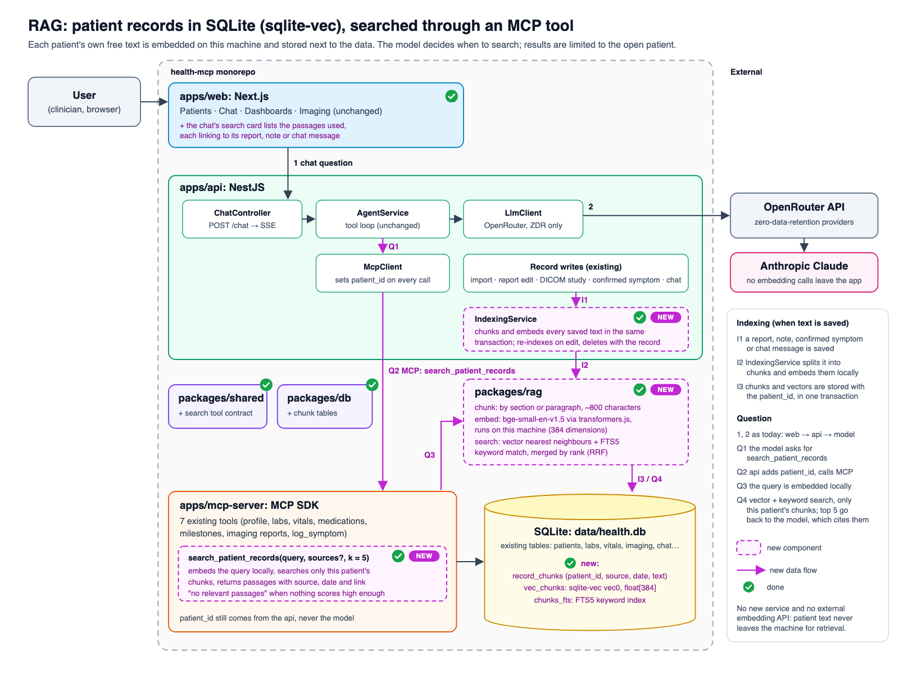

# RAG over patient records

Retrieval-augmented generation (RAG) for the assistant, built for learning. Each patient's own free text is split into chunks, embedded on this machine and stored in the existing SQLite file with [sqlite-vec](https://github.com/asg017/sqlite-vec). The model searches it through an MCP tool, limited to the open patient like every other tool. Synthetic data only, as everywhere in this repo.

The diagram builds on today's architecture ([architecture.png](architecture.png)); new parts are dashed magenta. The editable source is [`rag.svg`](rag.svg).

## Design

| | |
|---|---|
| **What is embedded** | Each patient's free text: radiology reports and impressions, clinician notes, symptom notes, past chat messages |
| **Vector store** | `sqlite-vec` inside the existing SQLite file: no new service |
| **Who decides to retrieve** | The model, through a new MCP tool `search_patient_records` (agentic RAG) |
| **Embeddings** | Local model (`bge-small-en-v1.5` via transformers.js, 384 dimensions) |
| **Search** | Vector nearest neighbours + SQLite FTS5 keywords, merged with reciprocal rank fusion |
| **When indexing happens** | On every write, in the same transaction as the record |
| **Isolation** | Every chunk carries `patient_id`, and vectors are partitioned by patient; the api sets the patient on the tool call, as for every other tool |
| **Privacy** | No text leaves the machine for retrieval |
| **Answer format** | The model cites the record (report, note, date) a passage came from; the chat's tool card shows the passages |
| **Infrastructure** | One SQLite extension and one npm model package |

## What it teaches

Chunking real records, local embeddings, metadata filtering for multi-tenant isolation, keeping an index consistent with its source (insert, update, delete), hybrid search, and agentic retrieval through MCP. It answers questions the structured tools cannot, such as "Has she mentioned dizziness before?" or "What did the reports say about the cavity over time?".

## Plan

Small steps, one commit each, with tests.

1. ✅ **Database:** `record_chunks`, the `vec_chunks` vector table (partitioned by patient) and the `chunks_fts` keyword index, kept in sync by triggers. `createDb` loads sqlite-vec.
2. ✅ **`packages/rag`, chunker:** split reports, notes, symptoms and the clinician's chat messages into chunks of about 800 characters (paragraph, then sentence, then word boundaries), overlapping by whole sentences, each starting with a title line such as "Imaging report: MRI brain (2026-08-18)". The assistant's own answers are not indexed.
3. ✅ **`packages/rag`, local embedder:** `LocalEmbedder` runs `bge-small-en-v1.5` (quantized, 34 MB) with transformers.js on the CPU; queries get BGE's search instruction, documents do not. `yarn rag:model` downloads the model once into `data/models/` (git-ignored); after that it works offline. A `HashingEmbedder` stands in for the model in tests.
4. ✅ **`packages/rag`, index and search:** `indexSource` replaces one record's chunks and vectors in a single transaction (or removes them). `searchPatientChunks` runs vector search (30 nearest, within the patient's partition) and FTS5 keyword search (common words dropped), merges them with reciprocal rank fusion and returns the top 5 with their similarity. Vector-only matches need a cosine similarity of at least 0.57: on the synthetic patients, off-topic questions reached at most 0.561 and the weakest real match 0.587.
5. **Indexing:** an `IndexingService` in the api, called wherever text is saved, and `yarn rag:reindex` to rebuild everything (also after changing the model or chunk size).
6. **MCP tool:** `search_patient_records` in the shared contract and the MCP server.
7. **Web:** the chat's search card shows each passage with a link to its source.
8. **Evals:** cases where the answer is only in free text (a note or an old report), plus retrieval checks (did the right chunk appear in the top 5).

## Open choices

- **Embedding model:** the vector size (384) is fixed by the migration; a model with another size needs a new one. Check current model names before building; `bge-small-en-v1.5` is a starting point.
- **Chunk size and overlap:** start with about 800 characters and tune them with the evals.
- **Relevance:** similarity scores of related medical topics overlap (asking about dizziness scores 0.66 against "trouble concentrating"), so the model judges relevance from the returned passages. A reranker model (a cross-encoder such as `bge-reranker-base`) would score relevance more sharply, at the cost of a second model.
